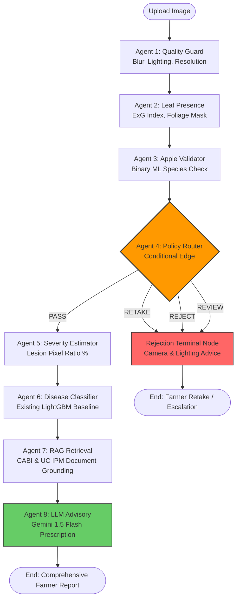

# AgriGuard-ML: Modular Multi-Agent AI Framework using LangGraph

## 1. System Overview

**AgriGuard-ML** uses a modular multi-agent architecture orchestrated with **LangGraph**. The pipeline preserves the verified **LightGBM** disease classification baseline on 848 handcrafted features, while wrapping it in:
1. **Deterministic Computer Vision validation** to inspect quality, detect plant foliage, and verify apple leaf species.
2. **LangGraph Conditional Routing** with explicit states: `RETAKE`, `REJECT`, `REVIEW`, and `PASS`.
3. **Objective Disease Severity Measurement** using OpenCV lesion-to-leaf pixel counting.
4. **Retrieval-Augmented Generation (RAG)** grounded in CABI PlantwisePlus and UC IPM agricultural extensions.
5. **A Single LLM Advisory Agent (Gemini 1.5 Flash)** with strict safety guardrails and deterministic fallback.



---

## 2. Modular Directory Structure

Instead of a monolithic script, each agent resides in its own isolated folder with independent unit tests:

```text
src/agents/
├── __init__.py
├── state.py                           # Unified LangGraph TypedDict schema
├── orchestrator.py                    # StateGraph construction & conditional routing
├── agent1_quality/
│   ├── __init__.py
│   └── quality_agent.py               # Blur, brightness, illumination, resolution
├── agent2_leaf_presence/
│   ├── __init__.py
│   └── leaf_presence_agent.py         # ExG index, foliage mask, contour validation
├── agent3_apple_validator/
│   ├── __init__.py
│   └── apple_validator_agent.py       # Binary species classifier, confidence checks
├── agent4_policy_router/
│   ├── __init__.py
│   └── policy_router.py               # Gatekeeper: RETAKE, REJECT, REVIEW, PASS
├── agent5_severity/
│   ├── __init__.py
│   └── severity_agent.py              # Lesion-to-leaf pixel percentage calculation
├── agent6_disease_classifier/
│   ├── __init__.py
│   └── disease_classifier.py          # Existing LightGBM wrapper & uncertainty gating
├── agent7_rag_retrieval/
│   ├── __init__.py
│   └── rag_agent.py                   # Vector & metadata retrieval from CABI / UC IPM
└── agent8_llm_advisory/
    ├── __init__.py
    └── advisory_agent.py              # Gemini 1.5 Flash grounded prescription & fallback
```

---

## 3. LangGraph Conditional Routing Logic

The **Agent 4 Policy Router** evaluates upstream outputs and directs execution into four explicit states:

| Policy State | Trigger Condition | Downstream Action |
|---|---|---|
| **`RETAKE`** | Blurry ($\text{score} < 75$), underexposed ($< 35$), or glare ($> 225$). | Terminates immediately. Provides camera distance & daylight instructions. |
| **`REJECT`** | No plant foliage ($< 12\%$ frame) or non-apple leaf confirmed. | Terminates immediately. Explains input is outside apple orchard scope. |
| **`REVIEW`** | Borderline species confidence ($0.50 \le P < 0.75$) or uncertain diagnosis ($P < 0.60$). | Routes to human agronomist review or requests secondary image. |
| **`PASS`** | High-confidence, validated apple leaf image. | Proceeds to Severity Estimation, LightGBM classification, RAG, and LLM advisory. |

---

## 4. Preservation of Existing Machine Learning Baseline

* **LightGBM Model**: The trained predictor (`models/LightGBM.joblib`) is invoked directly on the standardized 848 handcrafted feature vector.
* **Soft Voting Ensemble**: The pre-assembled `models/Voting_Ensemble.joblib` remains available as an alternative ensemble checkpoint.
* **Deterministic Calculations**: No LLM is permitted to guess blur scores, leaf boundaries, or lesion percentages. All physical metrics are calculated via OpenCV.

---

## 5. How to Run

### 1. Install Dependencies
```powershell
pip install langgraph langchain-core google-generativeai opencv-python joblib
```

### 2. Configure Environment (Optional for Live Gemini Advisory)
```powershell
$env:GEMINI_API_KEY="your-google-ai-studio-api-key"
```
*(If no API key is set, the system automatically uses the deterministic offline advisory template).*

### 3. Run the Multi-Agent Pipeline
```powershell
python -m src.agents.orchestrator "Data/test/Apple___Apple_scab/example.JPG"
```
