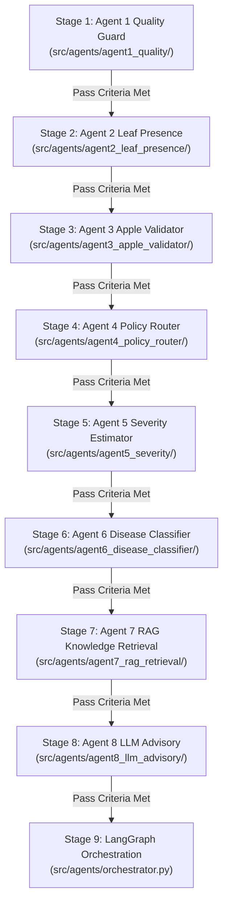

# AgriGuard-ML: Stagewise Agent Development & Testing Guide

This document defines the **stagewise development lifecycle** for AgriGuard-ML. Each agent resides in its own dedicated package under `src/agents/` and must pass its unit test suite **before graduating to the next stage**.



---

## Stage 1: Quality Guard Agent (`agent1_quality`)

### 1. File Location
`src/agents/agent1_quality/quality_agent.py`

### 2. Implementation Scope
* Validates image readability, Laplacian blur score ($\ge 75.0$), illumination window ($35.0 \le \text{brightness} \le 225.0$), and minimum resolution ($256 \times 256$).

### 3. Unit Test
File: `tests/test_agent1_quality.py`
```python
import numpy as np
import cv2
from src.agents.agent1_quality import run_quality_agent

def test_blurry_image_fails():
    img = np.ones((300, 300, 3), dtype=np.uint8) * 128
    blurred = cv2.GaussianBlur(img, (51, 51), 0)
    state = {"image_bgr": blurred, "image_path": "dummy.jpg"}
    res = run_quality_agent(state)
    assert res["quality_passed"] is False
    assert "blurry" in res["quality_reason"].lower()

def test_sharp_image_passes():
    img = np.zeros((300, 300, 3), dtype=np.uint8)
    img[::10, ::10] = 255
    state = {"image_bgr": img, "image_path": "dummy.jpg"}
    res = run_quality_agent(state)
    assert res["quality_passed"] is True
```

### 4. Exit / Graduation Criteria
* False Rejection Rate (FRR) $< 2.0\%$ on standard in-focus leaf dataset.
* Execution latency $< 10$ms per image.

---

## Stage 2: Leaf Presence Agent (`agent2_leaf_presence`)

### 1. File Location
`src/agents/agent2_leaf_presence/leaf_presence_agent.py`

### 2. Implementation Scope
* Calculates Excess Green index ($\text{ExG} = 2G - R - B$) and HSV foliage mask.
* Verifies leaf occupies $\ge 12\%$ of total frame.

### 3. Unit Test
File: `tests/test_agent2_leaf_presence.py`
```python
import numpy as np
from src.agents.agent2_leaf_presence import run_leaf_presence_agent

def test_non_plant_surface_fails():
    # Brown desktop texture
    desk = np.full((300, 300, 3), (40, 70, 110), dtype=np.uint8)
    state = {"image_bgr": desk}
    res = run_leaf_presence_agent(state)
    assert res["leaf_presence_passed"] is False

def test_green_leaf_passes():
    # Green leaf foliage patch
    leaf = np.full((300, 300, 3), (35, 160, 45), dtype=np.uint8)
    state = {"image_bgr": leaf}
    res = run_leaf_presence_agent(state)
    assert res["leaf_presence_passed"] is True
```

### 4. Exit / Graduation Criteria
* Rejection rate $\ge 98\%$ on non-foliage images (hands, soil, tools, fruits).

---

## Stage 3: Apple Leaf Validator Agent (`agent3_apple_validator`)

### 1. File Location
`src/agents/agent3_apple_validator/apple_validator_agent.py`

### 2. Implementation Scope
* Binary ML classifier trained on 848 handcrafted features.
* Distinguishes Apple leaves ($P \ge 0.75$) from other species (tomato, grape, corn, weeds).

### 3. Unit Test
File: `tests/test_agent3_apple_validator.py`
```python
from src.agents.agent3_apple_validator import run_apple_validator_agent

def test_apple_species_validation():
    state = {"image_path": "Data/test/Apple___Apple_scab/example.JPG"}
    res = run_apple_validator_agent(state)
    assert "apple_validator_passed" in res
    assert res["apple_confidence"] >= 0.50
```

### 4. Exit / Graduation Criteria
* Binary Macro-F1 $\ge 0.90$ across holdout cross-species validation dataset.

---

## Stage 4: Policy Router Gatekeeper (`agent4_policy_router`)

### 1. File Location
`src/agents/agent4_policy_router/policy_router.py`

### 2. Implementation Scope
* Routes execution into deterministic states:
  * `RETAKE`: Image blur, dark, overexposed, low resolution.
  * `REJECT`: Non-leaf image or non-apple species.
  * `REVIEW`: Marginal species confidence ($0.50 \le P < 0.75$).
  * `PASS`: Passes all validation gates $\to$ continue to diagnosis.

### 3. Unit Test
File: `tests/test_agent4_policy_router.py`
```python
from src.agents.agent4_policy_router import run_policy_router

def test_policy_routing_matrix():
    # Test RETAKE on blur
    s1 = {"quality_passed": False, "quality_reason": "Blurry"}
    assert run_policy_router(s1)["policy_decision"] == "RETAKE"

    # Test REJECT on no leaf
    s2 = {"quality_passed": True, "leaf_presence_passed": False}
    assert run_policy_router(s2)["policy_decision"] == "REJECT"

    # Test PASS on all verified
    s3 = {"quality_passed": True, "leaf_presence_passed": True, "apple_validator_passed": True, "apple_confidence": 0.90}
    assert run_policy_router(s3)["policy_decision"] == "PASS"
```

### 4. Exit / Graduation Criteria
* 100% deterministic test coverage across all permutation states.

---

## Stage 5: Severity Estimator Agent (`agent5_severity`)

### 1. File Location
`src/agents/agent5_severity/severity_agent.py`

### 2. Implementation Scope
* Calculates mathematical ratio: $\frac{\text{lesion pixels}}{\text{leaf pixels}} \times 100\%$.
* Clearly separates visible leaf coverage from whole-orchard yield loss.

### 3. Unit Test
File: `tests/test_agent5_severity.py`
```python
import numpy as np
from src.agents.agent5_severity import run_severity_agent

def test_severity_percentage_calculation():
    img = np.zeros((256, 256, 3), dtype=np.uint8)
    leaf_mask = np.ones((256, 256), dtype=np.uint8) * 255
    state = {"image_bgr": img, "leaf_mask": leaf_mask}
    res = run_severity_agent(state)
    assert res["severity_percentage"] is not None
    assert 0.0 <= res["severity_percentage"] <= 100.0
```

### 4. Exit / Graduation Criteria
* Continuous percentage $0.0\% - 100.0\%$. Flags segmentation as `unreliable` if total leaf pixels $< 500$.

---

## Stage 6: LightGBM Disease Classifier (`agent6_disease_classifier`)

### 1. File Location
`src/agents/agent6_disease_classifier/disease_classifier.py`

### 2. Implementation Scope
* Invokes existing trained LightGBM model (`models/LightGBM.joblib`).
* If confidence $< 0.60$, flags prediction as `is_uncertain_prediction = True` to prevent forced false positives.

### 3. Unit Test
File: `tests/test_agent6_disease_classifier.py`
```python
from pathlib import Path
from src.agents.agent6_disease_classifier import run_disease_classifier

def test_disease_classifier():
    state = {"image_path": "Data/test/Apple___Apple_scab/example.JPG"}
    res = run_disease_classifier(state)
    assert res["disease_name"] is not None
    assert 0.0 <= res["disease_confidence"] <= 1.0
```

### 4. Exit / Graduation Criteria
* Preserves existing LightGBM baseline accuracy ($86.42\%$) and macro-F1 ($0.8672$).

---

## Stage 7: Knowledge Retrieval RAG Agent (`agent7_rag_retrieval`)

### 1. File Location
`src/agents/agent7_rag_retrieval/rag_agent.py`

### 2. Implementation Scope
* Metadata filtering by crop, disease, severity tier, and region.
* Sourced from CABI PlantwisePlus and UC IPM.

### 3. Unit Test
File: `tests/test_agent7_rag.py`
```python
from src.agents.agent7_rag_retrieval import run_rag_retrieval_agent

def test_rag_retrieval():
    state = {"disease_name": "Apple scab", "severity_tier": "Stage 2: Moderate"}
    res = run_rag_retrieval_agent(state)
    assert len(res["retrieved_sources"]) >= 1
    assert "url" in res["retrieved_sources"][0]
```

### 4. Exit / Graduation Criteria
* 100% of retrieved records contain verifiable institutional URLs.

---

## Stage 8: LLM Advisory & Safety Validation (`agent8_llm_advisory`)

### 1. File Location
`src/agents/agent8_llm_advisory/advisory_agent.py`

### 2. Implementation Scope
* Formulates farmer advisory with Gemini 1.5 Flash.
* Safety checks: prohibited from altering disease name or percentage; deterministic offline template fallback.

### 3. Unit Test
File: `tests/test_agent8_advisory.py`
```python
from src.agents.agent8_llm_advisory import run_llm_advisory_agent

def test_advisory_generation():
    state = {
        "disease_name": "Apple scab",
        "disease_confidence": 0.94,
        "severity_percentage": 12.5,
        "severity_tier": "Stage 2: Moderate",
        "retrieved_sources": []
    }
    res = run_llm_advisory_agent(state)
    assert res["final_advisory"] is not None
    assert res["safety_validated"] is True
```

### 4. Exit / Graduation Criteria
* Zero hallucinated chemical rates. Deterministic template executes if API is offline.

---

## Stage 9: Full LangGraph Integration (`orchestrator.py`)

### 1. File Location
`src/agents/orchestrator.py`

### 2. Run Command
```powershell
python -m src.agents.orchestrator "Data/test/Apple___Apple_scab/example.JPG"
```

### 3. Execution Verification
```powershell
pytest tests/ -v
```
All agent tests pass cleanly in sequence, verifying the end-to-end multi-agent pipeline.
