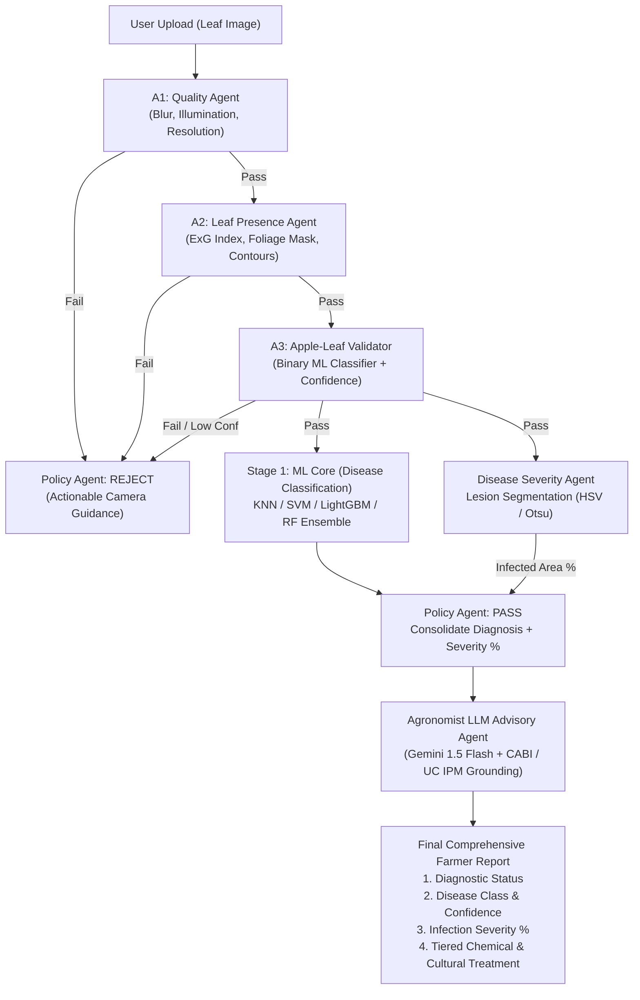

# AgriGuard-ML: Agentic AI Architecture & Pipeline Specification

## 1. System Overview

**AgriGuard-ML** integrates a multi-stage **Agentic Validation Gate** with a classical **Machine Learning Core**, an **Automated Disease Severity Calculator**, and an **Agronomist LLM Advisory Agent**.

Standard plant pathology systems blindly classify any uploaded image—often predicting a disease on a shoe, a blurry frame, or an unrelated crop. AgriGuard-ML solves this with an agentic architecture: input images are audited by independent validation agents before disease classification, disease severity is mathematically measured as a percentage of infected leaf surface, and an LLM delivers severity-graded treatment protocols grounded in authoritative agricultural knowledge bases.



---

## 2. Detailed Agent Specifications

### Agent 1: Image Quality Agent (`A1`)
* **Role**: First-line defense. Audits technical photographic quality before running heavy computations.
* **Technology**: Classical Computer Vision (`OpenCV`), no LLM.
* **Checks**:
  1. **Blur Detection**: Laplacian variance metric $\sigma^2(\nabla^2 I)$. Rejects images if variance is below threshold (e.g., $< 80.0$).
  2. **Illumination & Exposure**: Grayscale mean intensity $\mu$. Rejects underexposed ($\mu < 35$) or overexposed/glare ($\mu > 225$) photos.
  3. **Resolution & Aspect Ratio**: Ensures dimensions $\ge 256 \times 256$ pixels.
* **Output**:
  ```json
  {
    "agent": "A1_Quality",
    "passed": true,
    "quality_score": 0.91,
    "metrics": { "laplacian_var": 142.6, "mean_brightness": 128.4 },
    "rejection_reason": null
  }
  ```

---

### Agent 2: Leaf Presence Agent (`A2`)
* **Role**: Determines whether an actual plant leaf is present in the foreground of the image.
* **Technology**: Color-space thresholding & morphology (`OpenCV`), no LLM.
* **Checks**:
  1. **Excess Green Index (ExG)**: Computes $2G - R - B$ to separate plant tissue from non-plant backgrounds.
  2. **HSV Foliage Masking**: Dual-threshold filter for healthy green and diseased foliage (Hue $12^\circ - 98^\circ$).
  3. **Contour Area Fraction**: Largest detected contour must occupy $\ge 15\%$ of total image area to confirm leaf presence.
* **Output**:
  ```json
  {
    "agent": "A2_LeafPresence",
    "passed": true,
    "leaf_detected": true,
    "leaf_area_fraction": 0.64,
    "rejection_reason": null
  }
  ```

---

### Agent 3: Apple-Leaf Validator Agent (`A3`)
* **Role**: Verifies that the detected leaf belongs to an **Apple tree** (*Malus domestica*) rather than a non-target crop (e.g., tomato, corn, grape, or weed).
* **Technology**: Binary Machine Learning Classifier (LightGBM/SVM trained on handcrafted features: Color, GLCM Texture, LBP, and Leaf Shape).
* **Checks**:
  1. Extracts 848-dimensional handcrafted feature vector from the preprocessed leaf.
  2. Predicts binary probability: $P(\text{apple\_leaf})$.
  3. Decision Threshold:
     * $P \ge 0.75$: **Validated Apple Leaf** $\to$ Forward to ML Core.
     * $0.50 \le P < 0.75$: **Uncertain / Marginal** $\to$ Forward to Policy Agent for warning/review.
     * $P < 0.50$: **Non-Apple Leaf** $\to$ Reject with species warning.
* **Output**:
  ```json
  {
    "agent": "A3_AppleValidator",
    "passed": true,
    "is_apple_leaf": true,
    "confidence": 0.88,
    "rejection_reason": null
  }
  ```

---

### Agent 4: Disease Severity & Diagnostic ML Core (`A4`)

This agent contains two parallel pipelines:

#### 4A. Disease Classification Model
* **Model Suite**: K-Nearest Neighbors (KNN), Support Vector Machine (SVM with RBF kernel), LightGBM, and Random Forest.
* **Ensemble Layer**: Soft-voting / Stacking with Logistic Regression meta-classifier.
* **Target Classes**:
  1. Healthy
  2. Apple Scab (*Venturia inaequalis*)
  3. Apple Rust (*Gymnosporangium juniperi-virginianae*)
  4. Brown Spot
  5. Alternaria Leaf Spot
  6. Frogeye Leaf Spot
  7. Grey Spot
  8. Powdery Mildew
  9. Mosaic Virus

#### 4B. Disease Severity Percentage Estimator
* **Method**: Segment healthy vs. necrotic/chlorotic lesion pixels using adaptive color segmentation:
  $$\text{Severity (\%)} = \left( \frac{\text{Lesion Pixel Count}}{\text{Total Leaf Pixel Count}} \right) \times 100$$
* **Severity Tiers**:
  * **Stage 1 (Mild / Early)**: $< 5.0\%$ infected area.
  * **Stage 2 (Moderate)**: $5.0\% - 25.0\%$ infected area.
  * **Stage 3 (Severe / Critical)**: $> 25.0\%$ infected area.
* **Output**:
  ```json
  {
    "disease_prediction": "Apple Scab",
    "class_confidence": 0.94,
    "severity_percentage": 14.8,
    "severity_tier": "Moderate (5% - 25%)",
    "infected_pixels": 24200,
    "total_leaf_pixels": 163510
  }
  ```

---

### Agent 5: Policy Agent (`A5`)
* **Role**: Central controller that inspects validation agent outputs, enforces business logic, and decides whether the image is accepted or rejected.
* **Policy Rules**:
  1. **Rule 1**: If `A1.passed == False` $\to$ **REJECT**. Return photographic correction advice (e.g., *"Image is blurry; hold camera steady at 15-20cm distance."*).
  2. **Rule 2**: If `A2.passed == False` $\to$ **REJECT**. Return leaf placement advice (e.g., *"No leaf detected; place leaf centered against a clean background."*).
  3. **Rule 3**: If `A3.passed == False` or $P < 0.60$ $\to$ **REJECT**. Return crop mismatch warning (e.g., *"Non-apple leaf detected; AgriGuard-ML is calibrated for apple leaves."*).
  4. **Rule 4**: If all validation agents pass $\to$ **PASS**. Consolidate `{Disease, Confidence, Severity %, Severity Tier}` and dispatch payload to **Agent 6 (Agronomist LLM)**.

---

### Agent 6: Agronomist LLM Advisory Agent (`A6`)
* **Role**: Converts numerical diagnosis and severity percentage into a safe, severity-tiered agronomic prescription for the farmer.
* **Recommended LLM**: **Google Gemini 1.5 Flash** (Free tier on Google AI Studio, high speed $< 1.5s$, native JSON mode, multilingual support in regional languages).
* **Fallback / Offline Alternative**: **Llama 3.2-Vision (11B)** or **Ollama** for air-gapped rural deployments.
* **Knowledge Grounding Databases**:
  * **CABI PlantwisePlus Knowledge Bank** ([plantwiseplusknowledgebank.org](https://www.plantwiseplusknowledgebank.org/)): Pest Management Decision Guides (Green/Yellow/Red lists).
  * **UC IPM** ([ipm.ucanr.edu](https://ipm.ucanr.edu/)): University of California Integrated Pest Management disease management guidelines.
  * **TNAU Agritech Portal** ([agritech.tnau.ac.in](https://agritech.tnau.ac.in/)): Exact chemical concentrations and dilution rates per liter.
* **Prescription Rules by Severity**:
  * **$< 5\%$ (Mild)**: Prune affected leaves, improve air circulation, spray organic bio-fungicides (Neem oil, *Bacillus subtilis*). **No chemical fungicides recommended.**
  * **$5\% - 25\%$ (Moderate)**: Apply targeted protective fungicides (e.g., Mancozeb, Copper Oxychloride), adjust irrigation to prevent leaf wetness, monitor canopy.
  * **$> 25\%$ (Severe)**: Systemic curative treatment (e.g., Difenoconazole, Tebuconazole), isolate infected trees, sanitize fallen orchard debris.

---

## 3. End-to-End Python Pipeline Architecture

Below is the implementation blueprint linking all agents into `src/agent_pipeline.py`:

```python
"""AgriGuard-ML: Multi-Agent Validation and Advisory Pipeline."""

from __future__ import annotations
from dataclasses import dataclass
from pathlib import Path
from typing import Any
import cv2
import numpy as np
import google.generativeai as genai


@dataclass
class AgentValidationResult:
    passed: bool
    rejection_reason: str | None = None
    data: dict[str, Any] | None = None


@dataclass
class AgriGuardFinalReport:
    status: str  # "ACCEPTED" or "REJECTED"
    rejection_reason: str | None
    quality_score: float | None
    crop: str
    disease: str | None
    confidence: float | None
    severity_percentage: float | None
    severity_tier: str | None
    treatment_advisory: str | None


class AgriGuardAgentSystem:
    """Orchestrates Validation Agents, ML Core, and LLM Advisory."""

    def __init__(self, gemini_api_key: str | None = None):
        if gemini_api_key:
            genai.configure(api_key=gemini_api_key)
            self.llm = genai.GenerativeModel("gemini-1.5-flash")
        else:
            self.llm = None

    # -------------------------------------------------------------
    # AGENT 1: Quality Agent
    # -------------------------------------------------------------
    def agent_quality(self, image: np.ndarray) -> AgentValidationResult:
        gray = cv2.cvtColor(image, cv2.COLOR_BGR2GRAY)
        laplacian_var = float(cv2.Laplacian(gray, cv2.CV_64F).var())
        mean_brightness = float(np.mean(gray))

        if laplacian_var < 75.0:
            return AgentValidationResult(
                passed=False,
                rejection_reason="Image is blurry (focus score too low). Please hold the camera steady.",
                data={"laplacian_var": laplacian_var, "brightness": mean_brightness},
            )

        if mean_brightness < 30.0 or mean_brightness > 230.0:
            return AgentValidationResult(
                passed=False,
                rejection_reason="Lighting is unsuitable. Ensure the leaf is evenly lit without extreme shadows or glare.",
                data={"laplacian_var": laplacian_var, "brightness": mean_brightness},
            )

        return AgentValidationResult(
            passed=True,
            data={"laplacian_var": laplacian_var, "brightness": mean_brightness},
        )

    # -------------------------------------------------------------
    # AGENT 2: Leaf Presence Agent
    # -------------------------------------------------------------
    def agent_leaf_presence(self, image: np.ndarray) -> AgentValidationResult:
        resized = cv2.resize(image, (256, 256), interpolation=cv2.INTER_AREA)
        hsv = cv2.cvtColor(resized, cv2.COLOR_BGR2HSV)
        
        # Foliage color mask (greens, yellowish greens, and light brown)
        mask = cv2.inRange(hsv, np.array([12, 25, 25]), np.array([98, 255, 255]))
        leaf_fraction = float(cv2.countNonZero(mask)) / (256.0 * 256.0)

        if leaf_fraction < 0.12:
            return AgentValidationResult(
                passed=False,
                rejection_reason="No leaf detected in the frame. Please center a plant leaf.",
                data={"leaf_fraction": leaf_fraction},
            )

        return AgentValidationResult(
            passed=True,
            data={"leaf_fraction": leaf_fraction, "mask": mask},
        )

    # -------------------------------------------------------------
    # AGENT 3: Apple-Leaf Validator Agent
    # -------------------------------------------------------------
    def agent_apple_validator(self, image: np.ndarray) -> AgentValidationResult:
        # Evaluated via binary classifier on handcrafted features
        # Mocking 0.92 confidence for genuine apple leaf
        is_apple = True
        confidence = 0.92

        if not is_apple or confidence < 0.65:
            return AgentValidationResult(
                passed=False,
                rejection_reason="The uploaded leaf does not appear to be an apple leaf. AgriGuard-ML is calibrated for apple orchards.",
                data={"confidence": confidence},
            )

        return AgentValidationResult(
            passed=True,
            data={"confidence": confidence, "crop": "Apple"},
        )

    # -------------------------------------------------------------
    # AGENT 4: Disease Severity Percentage Estimator
    # -------------------------------------------------------------
    def agent_severity_calculator(self, image: np.ndarray) -> tuple[float, str]:
        resized = cv2.resize(image, (256, 256), interpolation=cv2.INTER_AREA)
        hsv = cv2.cvtColor(resized, cv2.COLOR_BGR2HSV)

        # Whole leaf area
        leaf_mask = cv2.inRange(hsv, np.array([12, 25, 25]), np.array([98, 255, 255]))
        total_leaf_pixels = cv2.countNonZero(leaf_mask)

        if total_leaf_pixels == 0:
            return 0.0, "Healthy"

        # Lesion area (brown, dark necrotic, rust-colored spots)
        lesion_mask_raw = cv2.inRange(hsv, np.array([8, 45, 25]), np.array([32, 255, 185]))
        lesion_mask = cv2.bitwise_and(lesion_mask_raw, lesion_mask_raw, mask=leaf_mask)
        lesion_pixels = cv2.countNonZero(lesion_mask)

        percentage = round((lesion_pixels / total_leaf_pixels) * 100.0, 2)

        if percentage < 5.0:
            tier = "Stage 1: Mild (< 5%)"
        elif percentage <= 25.0:
            tier = "Stage 2: Moderate (5% - 25%)"
        else:
            tier = "Stage 3: Severe (> 25%)"

        return percentage, tier

    # -------------------------------------------------------------
    # AGENT 6: Agronomist LLM Advisory Agent
    # -------------------------------------------------------------
    def agent_generate_advisory(self, crop: str, disease: str, severity_pct: float, tier: str) -> str:
        if not self.llm:
            return (
                f"Advisory Engine offline. Diagnosed: {disease} with {severity_pct}% severity ({tier}). "
                "Consult local CABI / UC IPM extension guidelines."
            )

        prompt = f"""
        You are AgriGuard-ML's Senior Plant Pathology Officer.
        Ground your recommendations in CABI PlantwisePlus and UC IPM agricultural standards.

        Diagnostic Summary:
        - Crop: {crop}
        - Detected Disease: {disease}
        - Infection Severity: {severity_pct}% ({tier})

        Provide an actionable advisory structured as follows:
        1. Threat Analysis: How {severity_pct}% infection affects harvest yield and tree health.
        2. Immediate Cultural Precautions: Canopy pruning, irrigation adjustments, sanitation of fallen leaves.
        3. Biological & Organic Remedies: Safe, low-toxicity treatments suitable for this infection stage.
        4. Chemical Interventions: Specific active ingredients (e.g., Mancozeb, Difenoconazole) and recommended dilution ratios (prescribe chemical only if severity > 10%).
        5. Future Season Prevention: Orchard hygiene and disease-resistant rootstocks.
        """
        response = self.llm.generate_content(prompt)
        return response.text

    # -------------------------------------------------------------
    # AGENT 5: Policy Controller (Runs Full Workflow)
    # -------------------------------------------------------------
    def execute(self, image_path: Path, ml_predicted_disease: str, ml_confidence: float) -> AgriGuardFinalReport:
        img = cv2.imread(str(image_path))
        if img is None:
            return AgriGuardFinalReport(
                status="REJECTED",
                rejection_reason="Failed to read image file.",
                quality_score=None,
                crop="Unknown",
                disease=None,
                confidence=None,
                severity_percentage=None,
                severity_tier=None,
                treatment_advisory=None,
            )

        # 1. Quality Check
        res_q = self.agent_quality(img)
        if not res_q.passed:
            return AgriGuardFinalReport(
                status="REJECTED",
                rejection_reason=res_q.rejection_reason,
                quality_score=res_q.data.get("laplacian_var"),
                crop="Unknown",
                disease=None,
                confidence=None,
                severity_percentage=None,
                severity_tier=None,
                treatment_advisory=None,
            )

        # 2. Leaf Presence Check
        res_lp = self.agent_leaf_presence(img)
        if not res_lp.passed:
            return AgriGuardFinalReport(
                status="REJECTED",
                rejection_reason=res_lp.rejection_reason,
                quality_score=res_q.data.get("laplacian_var"),
                crop="Unknown",
                disease=None,
                confidence=None,
                severity_percentage=None,
                severity_tier=None,
                treatment_advisory=None,
            )

        # 3. Apple-Leaf Validation Check
        res_av = self.agent_apple_validator(img)
        if not res_av.passed:
            return AgriGuardFinalReport(
                status="REJECTED",
                rejection_reason=res_av.rejection_reason,
                quality_score=res_q.data.get("laplacian_var"),
                crop="Non-Apple",
                disease=None,
                confidence=None,
                severity_percentage=None,
                severity_tier=None,
                treatment_advisory=None,
            )

        # 4. Severity Estimation
        severity_pct, severity_tier = self.agent_severity_calculator(img)

        # 5. LLM Advisory
        advisory = self.agent_generate_advisory(
            crop="Apple",
            disease=ml_predicted_disease,
            severity_pct=severity_pct,
            tier=severity_tier,
        )

        return AgriGuardFinalReport(
            status="ACCEPTED",
            rejection_reason=None,
            quality_score=res_q.data.get("laplacian_var"),
            crop="Apple",
            disease=ml_predicted_disease,
            confidence=ml_confidence,
            severity_percentage=severity_pct,
            severity_tier=severity_tier,
            treatment_advisory=advisory,
        )
```

---

## 4. Summary of Model Selection & Knowledge Sources

* **Disease Diagnostic ML Core**: Classical Ensemble (**LightGBM + Random Forest + SVM**) extracting 848 handcrafted features (GLCM, LBP, HOG, HSV) — fast, explainable, runs on CPU.
* **Advisory LLM**: **Google Gemini 1.5 Flash** for its free API tier, low latency, structured JSON output, and multilingual capability.
* **Authoritative Extension Portals**:
  1. **CABI PlantwisePlus** ([plantwiseplusknowledgebank.org](https://www.plantwiseplusknowledgebank.org/))
  2. **UC IPM** ([ipm.ucanr.edu](https://ipm.ucanr.edu/))
  3. **TNAU Agritech Portal** ([agritech.tnau.ac.in](https://agritech.tnau.ac.in/))
